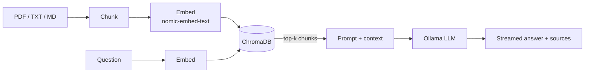

# 📚 Local RAG Chat

A ChatGPT-style assistant that answers questions about **your own documents**, running **100% locally**.
No API keys, no cloud, no data leaving your machine.

- **LLM:** [Ollama](https://ollama.com) (default `llama3.2:3b`)
- **Embeddings:** `nomic-embed-text` via Ollama
- **Vector DB:** ChromaDB (persistent, local)
- **UI:** Streamlit chat with streaming and source citations
- **Agent mode:** LLM router that picks between document search, a safe calculator, or plain chat

## How it works



## Quick start with Docker (recommended)

Requirements: [Docker](https://docs.docker.com/get-docker/) with Compose.

```bash
git clone https://github.com/<your-username>/local-rag-chat.git
cd local-rag-chat
docker compose up --build
```

The first run downloads the models (about 2.5 GB), so give it a few minutes. When the logs show Streamlit running, open **http://localhost:8501**.

Then: upload documents in the sidebar, click **Index uploaded files**, and start chatting.

Stop with `Ctrl+C` or `docker compose down`. Add `-v` to also delete downloaded models and the index.

### Change the model

```bash
cp .env.example .env      # edit LLM_MODEL, e.g. qwen2.5:3b, mistral, llama3.1:8b
docker compose up --build
```

### NVIDIA GPU

Install the [NVIDIA Container Toolkit](https://docs.nvidia.com/datacenter/cloud-native/container-toolkit/latest/install-guide.html), then uncomment the `deploy:` block under the `ollama` service in `docker-compose.yml`.

### Already running Ollama on your host?

Remove the `ollama` and `model-puller` services, and set `OLLAMA_HOST=http://host.docker.internal:11434` for the `app` service (on Linux add `extra_hosts: ["host.docker.internal:host-gateway"]`).

## Run without Docker

```bash
# 1. Install Ollama from https://ollama.com, then:
ollama pull llama3.2:3b
ollama pull nomic-embed-text

# 2. Python environment
python -m venv .venv && source .venv/bin/activate   # Windows: .venv\Scripts\activate
pip install -r requirements.txt

# 3. Launch
streamlit run app.py
```

## Configuration

| Variable | Default | Description |
|---|---|---|
| `OLLAMA_HOST` | `http://localhost:11434` | Ollama server URL |
| `LLM_MODEL` | `llama3.2:3b` | Chat model |
| `EMBED_MODEL` | `nomic-embed-text` | Embedding model |
| `DB_PATH` | `./chroma_db` | Vector store location |
| `CHUNK_SIZE` | `800` | Characters per chunk |
| `CHUNK_OVERLAP` | `150` | Overlap between chunks |
| `TOP_K` | `4` | Chunks retrieved per question |

## Project structure

```
.
├── app.py               # Streamlit UI
├── rag.py               # Ingest, retrieve, route, generate
├── requirements.txt
├── Dockerfile
├── docker-compose.yml   # ollama + model puller + app
├── .env.example
└── data/                # optional place for your own files
```

## Troubleshooting

- **"Could not reach Ollama"**: wait for the `model-puller` container to finish (`docker compose logs -f model-puller`).
- **Slow answers**: use a smaller model (`llama3.2:1b`) or enable GPU.
- **Wrong or empty answers**: re-index after changing `EMBED_MODEL` (use *Clear* by deleting the `chroma_data` volume), or raise `TOP_K`.
- **Scanned PDFs return nothing**: they contain images, not text. Run OCR first (e.g. `ocrmypdf`).

## Roadmap

- [ ] Hybrid search (BM25 + vectors) and reranking
- [ ] More loaders (DOCX, HTML, web pages)
- [ ] Conversation-aware query rewriting
- [ ] Evaluation script (retrieval hit rate)

## License

MIT
